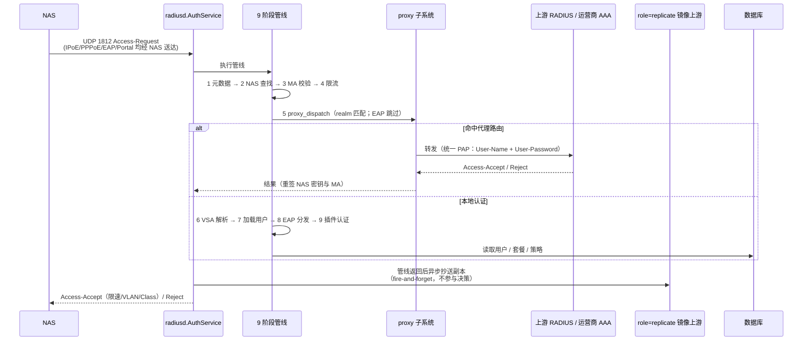
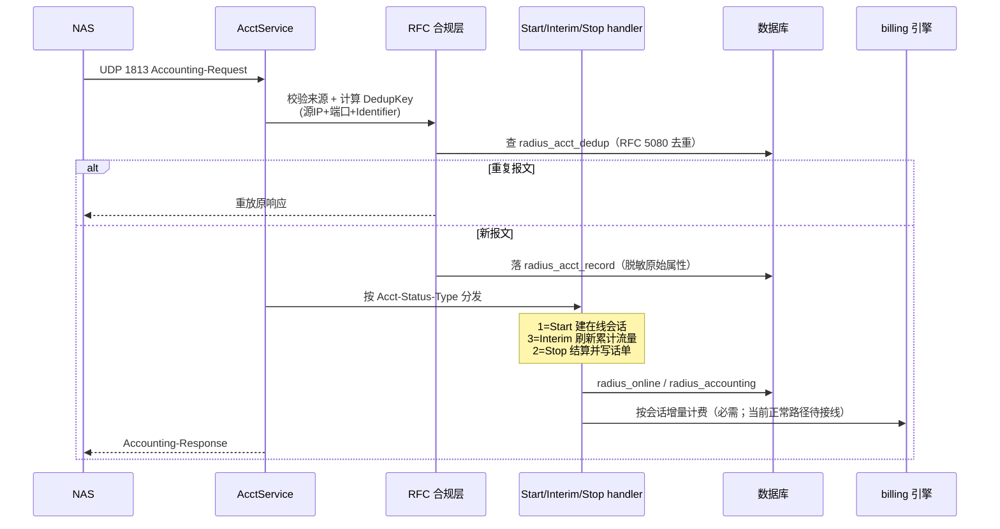
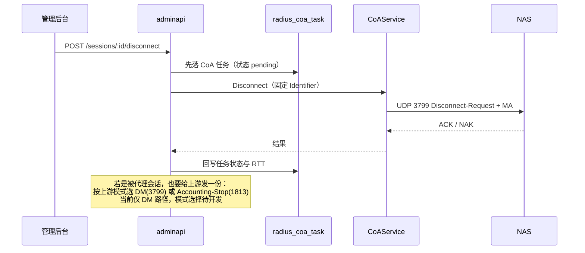
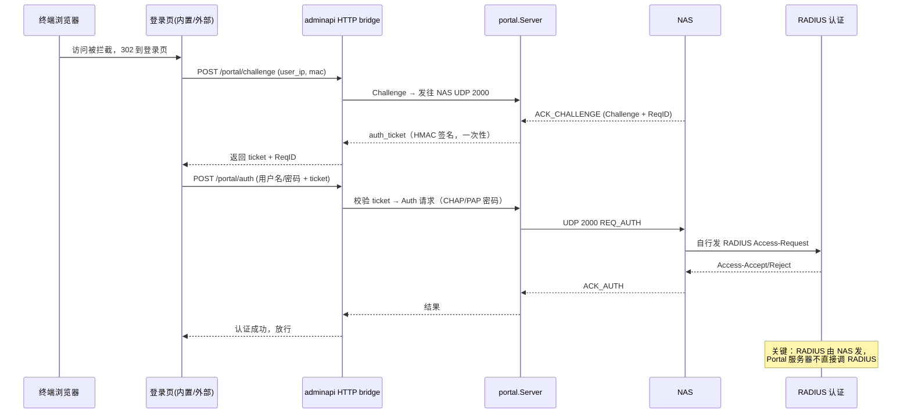
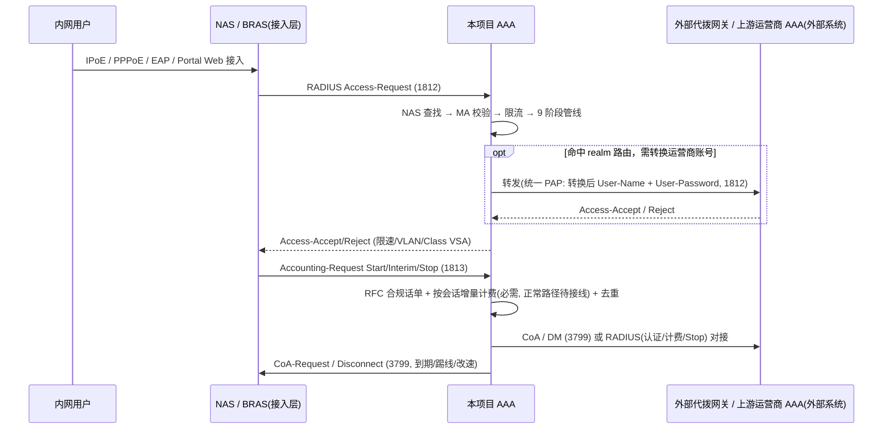
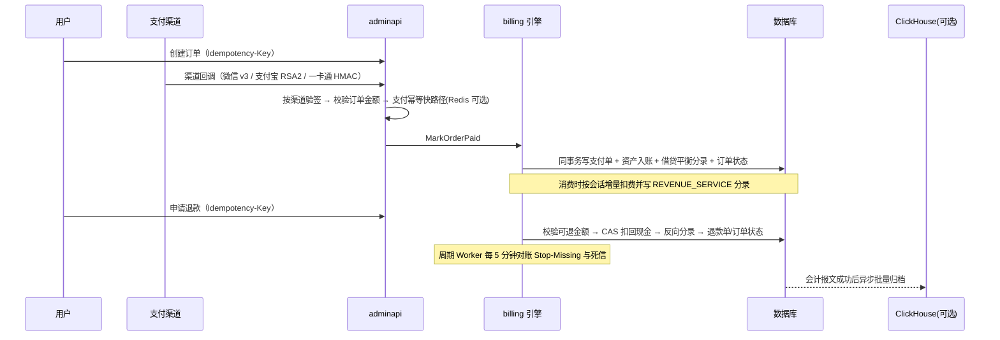
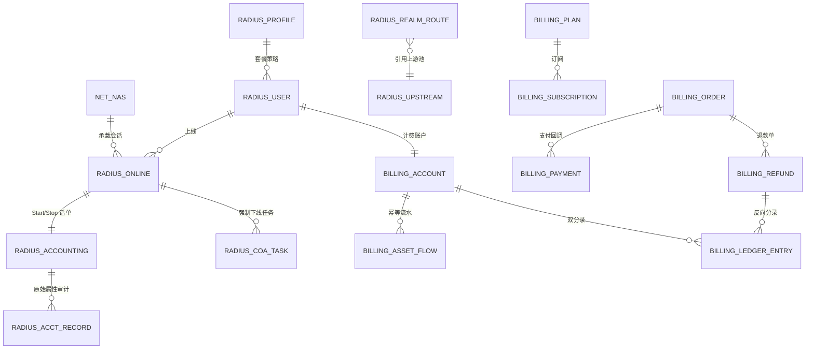

# ToughRADIUS 项目说明：架构与业务流转

> 本文面向"第一次接触本项目"的读者：用图和文字讲清**项目是什么、代码怎么分层、一次认证/计费/下线请求
> 在代码里怎么流转**。状态与验收口径以 [`ARCHITECTURE-BASELINE.md`](./ARCHITECTURE-BASELINE.md) 为准。
> 基于 `dev-freeradius-compare` 分支 `ab2175b`（2026-11-27）。

---

## 1. 一句话认识项目

ToughRADIUS 是一个用 Go 写的 RADIUS/AAA 服务器：设备（NAS/BRAS/AP）把用户的认证、计费请求发过来，
它负责**验明身份、决定授权、记录会话与话单、扣费、并支持强制下线**。同时带一个 React 管理后台，
以及经过四批二开扩展的代理转发/抄送/漫游、Portal V2 协议侧、账务与对账等商业化能力。

它既是一个标准的 RADIUS daemon（1812/1813/2083/3799），也在向"可运营的认证计费平台"演进。
**边界**：接入层（IPoE/PPPoE/EAP/Portal Web）、DHCP/DNS/DHCPv6 引流与 Portal Web 登录页 URL
均由 **NAS** 承担；PPPoE 代拨聚合网关是**外部独立系统**，本项目只以 RADIUS/CoA 对接。

---

## 2. 分层架构

```mermaid
flowchart TB
    subgraph 终端与外部系统
        U[终端用户]
        NAS[NAS / BRAS / AP<br/>接入层: IPoE / PPPoE / EAP / Portal Web<br/>地址推送 / 引流 / Portal URL 配置]
        DIAL[外部代拨网关 / 上游运营商 AAA<br/>外部独立系统, 本项目不实现<br/>全接入类型账号转换目标]
        PORTAL[外部 Portal Web 登录页<br/>URL 在 NAS 上配置]
    end

    subgraph ToughRADIUS 单二进制进程
        direction TB
        NET[接入网参考实现(边界外, 默认关闭)<br/>DHCPv4 / DNS / DHCPv6 / Captive<br/>生产由 NAS 承担, 不纳入交付面]
        RAD[AAA 数据面<br/>internal/radiusd]
        PROXY[代理子系统<br/>radiusd/proxy]
        PORTALSRV[Portal V2 协议侧<br/>internal/portal]
        BILL[计费引擎<br/>internal/billing]
        CTRL[管理控制面<br/>adminapi + webserver]
        APP[装配与配置<br/>internal/app + config]
    end

    DB[(PostgreSQL / SQLite<br/>29 张表)]
    EXT[上游 RADIUS / 运营商 AAA<br/>镜像抄送 / DNS 服务器]

    U -->|IPoE / PPPoE / EAP / Portal Web| NAS
    U -->|HTTP| PORTAL
    NAS -->|RADIUS 1812/1813| RAD
    NAS -->|地址 / Portal URL / 引流| U
    RAD -->|转发(统一 PAP) / CoA-DM 3799| DIAL
    NAS <-->|Portal V2: 本项目 50100 ↔ NAS 2000| PORTALSRV
    RAD <--> PROXY
    PROXY <-->|转发 / 抄送| EXT
    RAD -->|话单 / 会话| DB
    RAD -->|计费事件| BILL
    BILL <--> DB
    PORTALSRV -->|auth_ticket / HTTP bridge| CTRL
    CTRL <--> DB
    APP --- RAD & CTRL & BILL & NET
    NAS <-->|CoA/DM 3799| RAD
```

**关键设计**：控制面与数据面同进程、不同职责；数据库是配置与业务事实的权威源；
**接入网引流由 NAS 承担**，仓库内对应模块为边界外参考实现、默认关闭、不纳入商业化交付面；
二开服务（代理 / Portal / DynAuth / 支付 / 缓存 / 归档）均需显式开启。
出站上游统一 PAP；**代拨不限接入类型**，IPoE/PPPoE/EAP/Portal 均可转换后转发上游运营商 AAA。

---

## 3. 代码目录地图

| 目录 | 作用 | 阅读入口 |
|---|---|---|
| `main.go` | 进程入口，`errgroup` 并行启动各服务 | 从这里看"哪些服务会被拉起" |
| `config/config.go` | 全部配置项 + 默认值 + 环境变量覆盖 | 找开关与端口 |
| `internal/domain/` | 29 个 GORM 实体与迁移清单 | `tables.go` 看全表 |
| `internal/radiusd/` | RADIUS 核心：`radius_auth.go`、`radius_acct.go`、`auth_stages.go` | 认证管线看 `auth_stages.go` |
| `internal/radiusd/plugins/` | EAP 方法、认证校验器、策略、VSA 解析、计费 handler | `plugins/init.go` 看注册清单 |
| `internal/radiusd/proxy/` | 代理转发、抄送、负载池 | `service.go` 看路由匹配 |
| `internal/radiusd/repository/gorm/` | 数据仓储实现 | `interfaces.go` 看抽象 |
| `internal/portal/` | Portal V2 协议、会话状态机、auth_ticket | `service.go` 看业务编排 |
| `internal/billing/` | 计费引擎与规则 | `engine.go` 看扣费主流程 |
| `internal/accessnet/` + `dhcp` / `dnsintercept` / `dhcpv6` / `captive` | **边界外参考实现**：接入网引流由 NAS 承担，默认关闭、不纳入交付面 | `bootstrap.go` 看启停开关（仅实验室用） |
| `internal/adminapi/` | `/api/v1` 管理 API 与开放 API | `adminapi.go` 看路由注册清单 |
| `internal/webserver/` | Echo HTTP 服务、JWT、静态 UI、captive 中间件 | `server.go` 看中间件链 |
| `web/src/` | React Admin 前端 | `App.tsx` 看资源页注册 |
| `miniprogram/` | 微信小程序登录 | `pages/login` |
| `docs/rfcs/` | 60+ RFC 原文（协议实现依据） | 查协议细节 |

---

## 4. 核心业务流转

### 4.1 一次 RADIUS 认证（Access-Request）



要点：
- **限流在代理之前**，保护后端；EAP 请求跳过代理，落本地方法引擎。
- **异步抄送副本（`role=replicate`）具体做什么**：`ServeRADIUS` 在**管线执行返回之后**、
  只要请求通过 NAS 校验且非 EAP，就**无条件**（与本地认证 / 代理分支、Accept / Reject 结果都无关）
  把原始请求逐属性复制一份，用该镜像上游自己的 Secret 重签（本地用户已知时附加
  `Class=profile=套餐名`），异步发给**所有** enabled 的 `role=replicate` 上游，`2s` 超时、
  不等待也不解析响应。它**不是写数据库**，不参与认证决策、不改变回 NAS 的结果、不产生计费扣费；
  失败只记日志与指标。用于旁路镜像 / 审计 / 同步 / 灰度 / 双写给其他 RADIUS、DNS 或分析服务器。
  与同步阻塞、决定认证结果的 `role=proxy` 完全不同。详见基线第 7.3 节。
- **出站凭据冻结为统一 PAP**：本项目 → 上游 RADIUS / 代拨网关 / 运营商 AAA 一律用
  `UserPrefix+本地名+UserSuffix` 与 `MappedPassword` 构造 `User-Name + User-Password`，
  **不使用 CHAP / MS-CHAPv2**，也不做有状态 EAP 中继；EAP 在本地终结后以 PAP 重构上游请求。
  代码现状仍会原样复制非 PAP 属性转发，属待收紧项（基线 7.2）。
- **接入方式无关**：IPoE / PPPoE / EAP / Portal Web 送来的认证一律进同一 9 阶段管线，
  均可命中 realm 路由转换后转发上游（澄清 7）。

### 4.2 计费与话单（Accounting）



要点：事件时间以 **Event-Timestamp(55)** 为准；流量用 **Gigawords** 合并成 64 位；
计费是"计量事实→扣费指令"的解耦，赠品优先、幂等键防重复扣费。

- **按会话增量计费是必需能力，不是可选开关**：Interim-Update / Stop 携带**累计**计数器，
  引擎以 `本次累计 − 上次累计` 的 delta 扣费，按 `Acct-Session-Id` 幂等，流量用 64 位合并值。
  `billing.ChargeSession` 已实现并有单元测试，但**正常 Accounting 处理路径
  （start/update/stop handler → `radius_acct.go`）尚未调用它**，当前仅死信重放调用；
  状态为"引擎已实现、正常路径待接线"，属待开发项。详见基线第 6.3 节，本轮暂不开发。

### 4.3 代理转发 / 抄送 / 漫游 / 负载均衡

用户在 `radius_realm_route` 里配一条域路由，就能同时实现四种能力：

| 场景 | 配置方式 | 代码路径 |
|---|---|---|
| 漫游 | `realm=edu.cn` 匹配 `user@edu.cn` | `proxy.Service.MatchRoute` → `SplitUsername` |
| 负载均衡 | `realm=*` 兜底 + `strategy=round_robin/weight` | `proxy.Service.Select` |
| 代理转发 | 上游 `role=proxy`，路由 `acct_mode=both/forward/local` | `auth_proxy_stage.go` / `acct_proxy.go` |
| 抄送 | 上游 `role=replicate` | `replicateAuthRequest` / `acct_proxy.go` |

运营商账号转换：`UserPrefix + 本地用户名 + UserSuffix` 重写用户名，`MappedPassword` 替换密码，
出站**统一 PAP**，不使用 CHAP / MS-CHAPv2。**账号转换与接入方式解耦**：IPoE / PPPoE / EAP /
Portal Web 经 NAS 送来的认证均可命中 realm 路由，转换后送外部代拨网关 / 上游运营商 AAA。

**给上游的强制下线（冻结策略，待开发）**：CoA / 踢线**也要给上游发一份**，按上游对接模式选择：
上游用 CoA/DM → 发 `Disconnect-Request`（DM，3799）；上游只有 RADIUS → 发
`Accounting-Request` with `Acct-Status-Type=Stop(2)`（1813）。当前代码只有 DM 路径
（`proxy_relay.go` 的 `relayDisconnectUpstream`、PANABIT Stop 联动），按模式选择与 Stop 路径待开发；
上游也可通过 3799 DAS 入站反向下发 CoA。详见基线第 9.3 节。

### 4.4 CoA / 强制下线



任务先落库后发送，Identifier 固定，重启后可用同一 ID 重投；待补租约 fencing 与 UNKNOWN 状态。
**上游下线用上游自己的 Secret，本地 NAS 下线用 NAS 自己的 Secret**，两者不得混用；
按上游对接模式选择 DM / Accounting-Stop 为冻结需求、当前待开发（基线 9.3）。

### 4.5 Portal Web 认证（华为/CMCC V2）



`auth_ticket` 绑定用户名/IP/MAC/Challenge、2 分钟有效、一次性消费，防重放与开放重定向。

**端口方向（用户确认）**：Portal Web 认证（华为/CMCC V2）报文由本项目**发给 NAS**，
**NAS 使用 UDP 2000**（`portal.nas_port=2000`、`portal_nas.port=2000`）；本项目 Portal Server
监听 **UDP 50100**，用于接收 NAS 的 ACK_CHALLENGE / ACK_AUTH / NTF_LOGOUT / 心跳。
设备侧把 Portal Server 指向本项目 50100，RADIUS Access-Request 仍由 NAS 发到本项目 1812。

**登录页归属（边界）**：**Portal Web 登录页 URL 在 NAS 上配置**，DHCP/DNS/DHCPv6 引流也由 NAS
给用户推送；本项目 Portal 模块只做 UDP 协议侧，**不托管登录页、不做用户引流**。
内置登录页（`internal/captive`）与 302 仅为参考实现，默认关闭且不纳入商业化交付面（见 4.6）。

### 4.6 接入网引流（DHCP/DNS/DHCPv6）—— **NAS 职责，本项目边界外**

**边界修正（用户确认）**：接入网引流**是 NAS 给用户推送**的，不是本项目的职责。
**Portal Web 登录页 URL 在 NAS 上配置**；本项目只接收 NAS 送来的 RADIUS（1812/1813）与
Portal V2 协议报文（50100 ↔ NAS 2000），不负责把用户引到登录页。

| 能力 | 依据 | 由谁承担 |
|---|---|---|
| DHCPv4 地址分配 + Option 160/243（Portal URL）、Option 82（电路/远端 ID） | RFC 2131/2132/3046/7710 | **NAS** |
| 未认证用户 DNS 重定向（A 记录指向 Portal IP）+ 白名单透传 | RFC 1035 | **NAS** |
| DHCPv6 地址/前缀 + Option 103（Portal URL）、DUID/地址→用户绑定 | RFC 3315/8415/7710 | **NAS** |
| 未授权浏览器 Captive 302 + 登录页 URL 配置 | 工程实践 | **NAS** |

仓库内 `internal/dhcp`、`internal/dnsintercept`、`internal/dhcpv6`、`internal/captive`、
`internal/accessnet/bootstrap.go` 是第四批留下的**协议参考实现**，全部默认关闭、
**不纳入商业化交付面**；`TOUGHRADIUS_DHCP_*` / `DNSREDIRECT_*` / `IPV6_*` 等开关仅供实验室联调，
生产部署不应启用。本轮**暂不开发**：代码保留、不删除、不接线；后续按边界清理时再决定移除。
见基线第 11.1 节。

### 4.7 NAS → 本项目 RADIUS → 外部代拨网关（全接入类型，非本项目实现）

**链路（用户确认）**：内网用户经 NAS（IPoE / PPPoE / EAP / Portal Web 均可）把认证送到本项目
RADIUS，本项目按需把校园账号转换为运营商账号，用 **CoA 或 RADIUS 协议**对接**外部代拨网关 /
上游运营商 AAA**。代拨网关是独立开发 / 独立部署的外部系统，本项目**不实现拨号本身**
（PPPoE Discovery、LCP、会话态与内核转发）。

> **不是只有拨号用户才代拨**：所有内网通过 NAS 送来的认证均可转换转发给上游运营商 AAA；
> 账号转换与接入方式解耦。



- **接入侧**：NAS 承担接入方式与引流；所有接入类型统一进 9 阶段管线。
- **出站侧统一 PAP**：本项目 → 上游 RADIUS / 代拨网关 / 运营商 AAA 一律
  `User-Name + User-Password`，**不使用 CHAP / MS-CHAPv2**；EAP 在本地终结后以 PAP 重构上游请求。
- **认证**：需要运营商账号时用 `proxy_dispatch` 转换后转发（`radius_realm_route` 配置）。
- **计费**：Start/Interim/Stop 落话单，`acct_mode` 决定本地/转发/两者；
  按会话增量计费为**必需**能力（当前正常路径待接线，见 4.2）。
- **控制与下线**：管理端或策略到期通过 `CoAService` 下发 CoA/DM（3799），任务先落库后发送；
  **给上游的下线按对接模式选择 DM 或 Accounting-Stop**（冻结策略，当前待开发，见基线 9.3）。
- 对接属性清单、厂商差异（锐捷/Drcom/Panabit/电信/移动/联通/XuJing）见
  `docs/dial-gateway-integration.md`；代拨网关作为 RADIUS Client 时登记于 `net_nas`，
  作为上游 AAA 时登记于 `radius_upstream`。
- 已补齐三类适配：① 上游请求侧 Filter-Id/VSA 注入与 DRCOM 属性裁剪（配置驱动，不硬编码运营商 IP）；
  ② 上游拒绝原因按用户名缓存 5 分钟，只回显文案；③ PANABIT Stop 自动向上游 CoA 端口发 Disconnect。

### 4.8 支付、财务账本与运营对账



运营对账入口：`POST /api/v1/billing/reconciliation`、`/reconciliation/nas-reboot`、
`/reconciliation/dead-letters`；账本查询：`GET /api/v1/billing/ledger`；退款：`POST /api/v1/billing/refunds`。
退款与账本均为幂等操作，重复回调不会二次入账或二次扣回。

---

## 5. 数据模型关系（主干）



- **认证侧**：`radius_user`（凭据/属性）→ `radius_online`（在线会话）→ `radius_accounting`（话单）。
- **运营侧**：`radius_upstream` + `radius_realm_route`（代理/漫游）；`portal_nas`（Portal 设备）。
- **计费侧**：`billing_*` 十二张表，覆盖账户、资产流水、套餐、订阅、用量、扣费、订单、支付、充值卡、
  双分录账本与退款单。
- 完整 29 张表见基线文档第 14 节。

---

## 6. 配置与端口速查

| 想做什么 | 配置项 / 环境变量 |
|---|---|
| 基本启动 | `toughradius.yml`；`-initdb` 初始化；`./toughradius -c toughradius.yml` |
| Web 管理端口 | `web.port=1816` / `TOUGHRADIUS_WEB_PORT` |
| JWT 密钥 | `web.secret` / `TOUGHRADIUS_WEB_SECRET`（生产必设） |
| RADIUS 端口 | `radiusd.auth_port=1812`、`acct_port=1813`、`radsec_port=2083` |
| 开启代理 | `radiusd.proxy_enabled=true` + `TOUGHRADIUS_RADIUS_PROXY_*` |
| 开启 CoA 入站 | `radiusd.dynauth_enabled=true` + `dynauth_port=3799` + `dynauth_secret` |
| 开启 Portal V2 协议侧 | `portal.enabled=true` + `TOUGHRADIUS_PORTAL_*`（本项目监听 UDP 50100） |
| Portal NAS 端口 | `portal.nas_port=2000` / `TOUGHRADIUS_PORTAL_NAS_PORT=2000` / `portal_nas.port=2000`；报文**发往 NAS UDP 2000** |
| 对接上游 / 代拨网关 | `radiusd.proxy_enabled=true` + `radius_upstream` / `radius_realm_route`（出站**统一 PAP**，全接入类型可转换） |
| 接入网引流（DHCP/DNS/DHCPv6） | **由 NAS 承担**；`dhcp.enabled` / `dns_redirect.enabled` / `ipv6.enabled` / `captive.enabled` 仅为边界外参考实现，生产不启用 |
| 开启开放 API | `openapi.enabled=true` + `TOUGHRADIUS_OPENAPI_CREDENTIALS=key:secret,...` |
| 开启支付渠道验签 | `payment.enabled=true` + `TOUGHRADIUS_PAYMENT_*`（生产必设，否则仅兼容裸 HMAC） |
| 开启 Redis 共享状态 | `cache.enabled=true` + `TOUGHRADIUS_CACHE_ADDR`（不可达时启动失败关闭） |
| 开启 ClickHouse 归档 | `analytics.enabled=true` + `TOUGHRADIUS_ANALYTICS_DSN` |

配置加载顺序：`-c` 指定 → 工作目录 → `/etc` → 默认值 → 环境变量覆盖。详见 `config/config.go`。

---

## 7. 开发与验证入口

```bash
# 后端构建与测试
go build ./...
go test -short ./internal/...        # -short 跳过依赖 sqlite 的 EAP 集成用例
go test ./internal/radiusd -bench=.  # 压测

# 前端
cd web && npm install && npm run build && cd ..

# 命令行工具
go run ./cmd/radtest ...        # 协议自测
go run ./cmd/certgen ...        # RadSec 证书
go run ./cmd/benchmark ...      # 压力测试

# 初始化与启动
./toughradius -initdb -c toughradius.yml
./toughradius -c toughradius.yml
```

**验证现状**（以基线第 19 节为准）：`go build ./...`、Linux 交叉编译与
`go test ./... -count=1` 全量通过（此前 Windows 路径/SQLite 路径问题已修复）。
前端依赖未安装，未执行 `npm run type-check`；真实设备互通、支付商户联调、压力测试与
生产数据库迁移演练仍**未验收**。

**2026-11-27 业务澄清轮**：本轮**仅更新文档、未改代码**，故不重复构建与测试。
已冻结但尚未实现的能力——出站统一 PAP 收紧、按会话增量计费正常路径接线、
给上游强制下线按模式选择 DM / Accounting-Stop——一律为**待开发**，不得计入已完成或已验证。

---

## 8. 如何读源码（建议路线）

1. **启动**：`main.go` →看 errgroup 拉起哪些服务 → `internal/app` 装配。
2. **认证主线**：`radius_auth.go` → `auth_stages.go`（9 阶段）→ 各 stage 函数 → `plugins/init.go`（注册清单）。
3. **计费主线**：`radius_acct.go` → `acct_plugin_runner.go` → `plugins/accounting/handlers/*`。
4. **二开能力**：代理看 `radiusd/proxy`；Portal 看 `internal/portal`；计费/对账/账本看 `internal/billing`；
   支付看 `internal/payment`；缓存与归档看 `internal/cache`、`internal/analytics`；
   `internal/accessnet` 等接入网包为**边界外参考实现**（生产由 NAS 承担），仅供协议参考。
5. **协议细节**：查 `docs/rfcs/` 对应 RFC 原文 + `docs/rfcs/README.md`。
6. **状态与边界**：随时对照 `ARCHITECTURE-BASELINE.md`，避免重复建设或夸大完成度。

---

## 9. 与其他文档的关系

| 文档 | 定位 |
|---|---|
| [`ARCHITECTURE-BASELINE.md`](./ARCHITECTURE-BASELINE.md) | **唯一有效**的架构与开发状态基线（状态矩阵、验收口径） |
| 本文（`PROJECT-GUIDE.md`） | 面向读者的架构与业务流转说明（怎么跑起来、请求怎么流转） |
| [`PROTOCOL-SPEC.md`](./PROTOCOL-SPEC.md) | **唯一有效**的协议规范与业务流程手册（报文结构、协议族端口辨析、交互顺序、安全校验、FreeRADIUS 对照、已知偏差清单） |
| `dial-gateway-integration.md` | 代拨/上游 AAA 对接契约（外部系统；全接入类型账号转换、RADIUS/CoA、属性清单与厂商差异） |
| `freeradius-comparison.md` | ToughRADIUS 与 FreeRADIUS 的功能模块对照证据 |
| `campus-aaa-second-dev.md` | 第三批二开（话单合规/计费/CoA/Portal 票据/开放 API）实现说明 |
| `campus-aaa-fourth-dev.md` | 第四批二开（九大模块）实现说明与权威协议依据 |
| `portal-v2-integration.md` | Portal V2 对接指南（报文算法、边界、限制） |
| `compliance/README.md` | 等保 2.0 三级技术措施说明模板（非测评报告） |
| `docs-site/` | 面向用户的双语 mdbook 手册（概述、运维、厂商对接等） |

> 本文与基线文档由同一开发流程维护：每次开发后同步更新，不新建并存版本。
