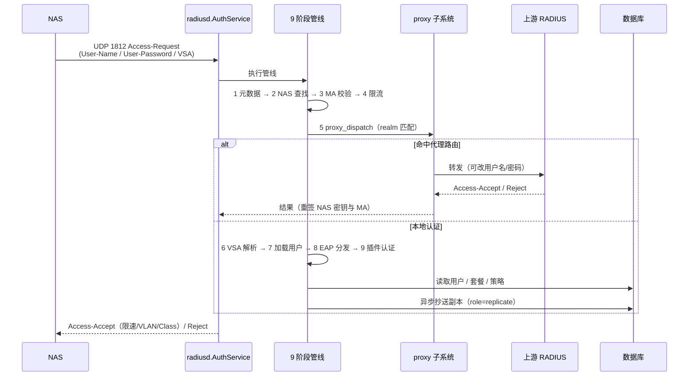
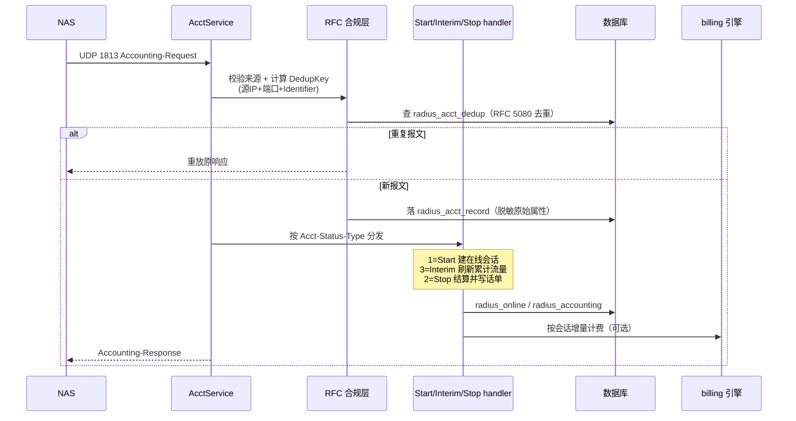
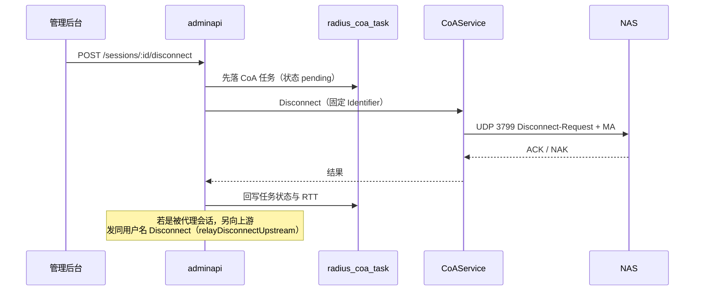
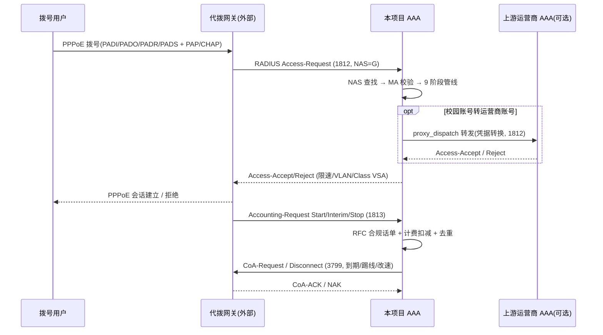
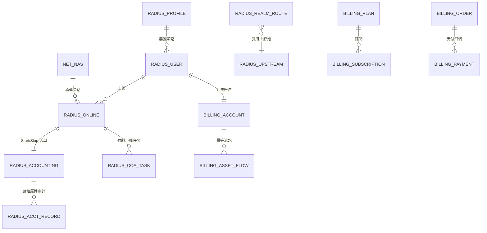

# ToughRADIUS 项目说明：架构与业务流转

> 本文面向"第一次接触本项目"的读者：用图和文字讲清**项目是什么、代码怎么分层、一次认证/计费/下线请求
> 在代码里怎么流转**。状态与验收口径以 [`ARCHITECTURE-BASELINE.md`](./ARCHITECTURE-BASELINE.md) 为准。
> 基于 `dev-freeradius-compare` 分支 `3e61b9d`（2026-11-27）。

---

## 1. 一句话认识项目

ToughRADIUS 是一个用 Go 写的 RADIUS/AAA 服务器：设备（NAS/BRAS/AP）把用户的认证、计费请求发过来，
它负责**验明身份、决定授权、记录会话与话单、扣费、并支持强制下线**。同时带一个 React 管理后台，
以及经过四批二开扩展的代理转发、Portal Web 认证、DHCP/DNS 引流等商业化能力。

它既是一个标准的 RADIUS daemon（1812/1813/2083/3799），也在向"可运营的认证计费平台"演进。

---

## 2. 分层架构

```mermaid
flowchart TB
    subgraph 终端与外部系统
        U[终端用户]
        NAS[NAS / BRAS / AP<br/>交换机 / 路由器]
        DIAL[代拨聚合网关(外部独立项目)<br/>PPPoE 拨号 / 会话转发<br/>RADIUS 1812·1813 + CoA 3799 对接]
        PORTAL[外部或内置<br/>Portal 登录页]
    end

    subgraph ToughRADIUS 单二进制进程
        direction TB
        NET[接入网层<br/>DHCPv4 / DNS / DHCPv6 / Captive<br/>internal/accessnet + dhcp* + dnsintercept]
        RAD[AAA 数据面<br/>internal/radiusd]
        PROXY[代理子系统<br/>radiusd/proxy]
        PORTALSRV[Portal V2<br/>internal/portal]
        BILL[计费引擎<br/>internal/billing]
        CTRL[管理控制面<br/>adminapi + webserver]
        APP[装配与配置<br/>internal/app + config]
    end

    DB[(PostgreSQL / SQLite<br/>27 张表)]
    EXT[上游 RADIUS / 运营商<br/>镜像抄送 / DNS 服务器]

    U -->|HTTP| PORTAL
    U -->|上网流量| NAS
    U -->|PPPoE 拨号| DIAL
    DIAL -->|RADIUS 1812/1813 (作为 NAS)| RAD
    RAD -->|CoA/DM 3799| DIAL
    PORTAL -->|UDP 50100 Portal V2| PORTALSRV
    NAS -->|RADIUS 1812/1813| RAD
    NET -->|地址 / Portal URL / 引流| U
    RAD <--> PROXY
    PROXY <-->|转发 / 抄送| EXT
    RAD -->|话单 / 会话| DB
    RAD -->|计费事件| BILL
    BILL <--> DB
    PORTALSRV -->|auth_ticket / HTTP bridge| CTRL
    CTRL <--> DB
    APP --- RAD & CTRL & BILL & NET
    NAS <-->|CoA/DM 3799| RAD
```

**关键设计**：控制面与数据面同进程、不同职责；数据库是配置与业务事实的权威源；
所有二开网络服务默认关闭，需显式开启。

---

## 3. 代码目录地图

| 目录 | 作用 | 阅读入口 |
|---|---|---|
| `main.go` | 进程入口，`errgroup` 并行启动各服务 | 从这里看"哪些服务会被拉起" |
| `config/config.go` | 全部配置项 + 默认值 + 环境变量覆盖 | 找开关与端口 |
| `internal/domain/` | 27 个 GORM 实体与迁移清单 | `tables.go` 看全表 |
| `internal/radiusd/` | RADIUS 核心：`radius_auth.go`、`radius_acct.go`、`auth_stages.go` | 认证管线看 `auth_stages.go` |
| `internal/radiusd/plugins/` | EAP 方法、认证校验器、策略、VSA 解析、计费 handler | `plugins/init.go` 看注册清单 |
| `internal/radiusd/proxy/` | 代理转发、抄送、负载池 | `service.go` 看路由匹配 |
| `internal/radiusd/repository/gorm/` | 数据仓储实现 | `interfaces.go` 看抽象 |
| `internal/portal/` | Portal V2 协议、会话状态机、auth_ticket | `service.go` 看业务编排 |
| `internal/billing/` | 计费引擎与规则 | `engine.go` 看扣费主流程 |
| `internal/accessnet/` | 接入网服务统一装配 | `bootstrap.go` 看启停开关 |
| `internal/adminapi/` | `/api/v1` 管理 API 与开放 API | `adminapi.go` 看路由注册清单 |
| `internal/webserver/` | Echo HTTP 服务、JWT、静态 UI、captive 中间件 | `server.go` 看中间件链 |
| `web/src/` | React Admin 前端 | `App.tsx` 看资源页注册 |
| `miniprogram/` | 微信小程序登录 | `pages/login` |
| `docs/rfcs/` | 60+ RFC 原文（协议实现依据） | 查协议细节 |

---

## 4. 核心业务流转

### 4.1 一次 RADIUS 认证（Access-Request）



要点：
- **限流在代理之前**，保护后端；EAP 请求跳过代理，落本地方法引擎。
- 抄送是 fire-and-forget：把用户信息与 `Class=profile=套餐名` 异步转发给镜像服务器。
- 凭据转换只在 PAP 下改写密码；CHAP/MSCHAPv2 是挑战式，无法替换密码，原样透传。

### 4.2 计费与话单（Accounting）



要点：事件时间以 **Event-Timestamp(55)** 为准；流量用 **Gigawords** 合并成 64 位；
计费是"计量事实→扣费指令"的解耦，赠品优先、幂等键防重复扣费。

### 4.3 代理转发 / 抄送 / 漫游 / 负载均衡

用户在 `radius_realm_route` 里配一条域路由，就能同时实现四种能力：

| 场景 | 配置方式 | 代码路径 |
|---|---|---|
| 漫游 | `realm=edu.cn` 匹配 `user@edu.cn` | `proxy.Service.MatchRoute` → `SplitUsername` |
| 负载均衡 | `realm=*` 兜底 + `strategy=round_robin/weight` | `proxy.Service.Select` |
| 代理转发 | 上游 `role=proxy`，路由 `acct_mode=both/forward/local` | `auth_proxy_stage.go` / `acct_proxy.go` |
| 抄送 | 上游 `role=replicate` | `replicateAuthRequest` / `acct_proxy.go` |

运营商账号转换：`UserPrefix + 本地用户名 + UserSuffix` 重写用户名，`MappedPassword` 替换密码。
管理端踢线时，通过 `proxy_relay.go` 向上游发 Disconnect（CoA 方式）；上游也可通过 3799 DAS 入站反向下发 CoA（RADIUS 协议方式）。

### 4.4 CoA / 强制下线



任务先落库后发送，Identifier 固定，重启后可用同一 ID 重投；待补租约 fencing 与 UNKNOWN 状态。

### 4.5 Portal Web 认证（华为/CMCC V2）


`auth_ticket` 绑定用户名/IP/MAC/Challenge、2 分钟有效、一次性消费，防重放与开放重定向。
内置登录页（`internal/captive`）默认关闭——遵守项目"不托管登录页"铁律，需显式开启。

### 4.6 接入网引流（DHCP/DNS/DHCPv6）

未认证用户如何被带到 Portal 页：

1. **DHCP（RFC 2131）**：给用户分配地址时，通过 Option 160（RFC 7710，兼容非标 243）下发 Portal URL；
   Option 82 回显电路/远端 ID 用于定位用户。
2. **DNS（RFC 1035）**：未认证用户的域名查询被劫持，A 记录返回 Portal IP；白名单域名透传上游。
3. **DHCPv6（RFC 3315/8415）**：分配 IPv6 地址/前缀，Option 103 下发 Portal URL；维护"地址→DUID/MAC→用户"绑定用于溯源。
4. **Captive 302**：未授权浏览器的 HTTP 请求被重定向到登录页，签名 return URL 防开放重定向。

四者默认关闭，由 `internal/accessnet/bootstrap.go` 按配置启停，并注入 webserver 的 captive 中间件。

### 4.7 与代拨网关对接（外部系统，非本项目实现）

PPPoE 代拨聚合网关是**独立开发/部署的外部系统**，负责 PPPoE Discovery、LCP/PAP/CHAP、
会话态与内核转发；本项目**不实现拨号**，只把它当作一台 NAS 对接：



- **认证**：代拨网关作为 NAS，走标准 9 阶段管线；需要运营商账号时用 `proxy_dispatch`
  把校园账号转换为运营商账号转发上游（`radius_realm_route` 配置）。
- **计费**：Start/Interim/Stop 落话单，`acct_mode` 决定本地/转发/两者。
- **控制**：管理端或策略到期通过 `CoAService` 向网关下发 CoA/DM（3799），任务先落库后发送。
- 对接属性清单、厂商差异（锐捷/Drcom/Panabit/电信/移动/联通/XuJing）与未实现适配项见
  `docs/dial-gateway-integration.md`。

---

## 5. 数据模型关系（主干）



- **认证侧**：`radius_user`（凭据/属性）→ `radius_online`（在线会话）→ `radius_accounting`（话单）。
- **运营侧**：`radius_upstream` + `radius_realm_route`（代理/漫游）；`portal_nas`（Portal 设备）。
- **计费侧**：`billing_*` 十张表，覆盖账户、资产流水、套餐、订阅、用量、扣费、订单、支付、充值卡。
- 完整 27 张表见基线文档第 14 节。

---

## 6. 配置与端口速查

| 想做什么 | 配置项 / 环境变量 |
|---|---|
| 基本启动 | `toughradius.yml`；`-initdb` 初始化；`./toughradius -c toughradius.yml` |
| Web 管理端口 | `web.port=1816` / `TOUGHRADIUS_WEB_PORT` |
| JWT 密钥 | `web.secret` / `TOUGHRADIUS_WEB_SECRET`（生产必设） |
| RADIUS 端口 | `radiusd.auth_port=1812`、`acct_port=1813`、`radsec_port=2083` |
| 开启代理 | `radiusd.proxy_enabled=true` + `TOUGHRADIUS_RADIUS_PROXY_*` |
| 开启 CoA 入站 | `radiusd.dynauth_enabled=true` + `dynauth_port=3799` + `dynauth_secret` |
| 开启 Portal | `portal.enabled=true` + `TOUGHRADIUS_PORTAL_*` |
| 开启 DHCP/DNS/引流 | `dhcp.enabled` / `dns_redirect.enabled` / `ipv6.enabled` / `captive.enabled` |
| 开启开放 API | `openapi.enabled=true` + `TOUGHRADIUS_OPENAPI_CREDENTIALS=key:secret,...` |

配置加载顺序：`-c` 指定 → 工作目录 → `/etc` → 默认值 → 环境变量覆盖。详见 `config/config.go`。

---

## 7. 开发与验证入口

```bash
# 后端构建与测试
go build ./...
go test -short ./internal/...        # -short 跳过依赖 sqlite 的 EAP 集成用例
go test ./internal/radiusd -bench=.  # 压测

# 前端
cd web && npm install && npm run build && cd ..

# 命令行工具
go run ./cmd/radtest ...        # 协议自测
go run ./cmd/certgen ...        # RadSec 证书
go run ./cmd/benchmark ...      # 压力测试

# 初始化与启动
./toughradius -initdb -c toughradius.yml
./toughradius -c toughradius.yml
```

**验证现状**（以基线第 19 节为准）：`go build ./...` 与 Linux 交叉编译通过；`go test -short ./internal/...`
56 包 ok、config 包因 Windows 路径分隔符失败（既有问题）。真实设备互通、压力测试、数据库迁移执行均**未验收**。

---

## 8. 如何读源码（建议路线）

1. **启动**：`main.go` →看 errgroup 拉起哪些服务 → `internal/app` 装配。
2. **认证主线**：`radius_auth.go` → `auth_stages.go`（9 阶段）→ 各 stage 函数 → `plugins/init.go`（注册清单）。
3. **计费主线**：`radius_acct.go` → `acct_plugin_runner.go` → `plugins/accounting/handlers/*`。
4. **二开能力**：代理看 `radiusd/proxy`；Portal 看 `internal/portal`；计费看 `internal/billing`；
   接入网看 `internal/accessnet`。
5. **协议细节**：查 `docs/rfcs/` 对应 RFC 原文 + `docs/rfcs/README.md`。
6. **状态与边界**：随时对照 `ARCHITECTURE-BASELINE.md`，避免重复建设或夸大完成度。

---

## 9. 与其他文档的关系

| 文档 | 定位 |
|---|---|
| [`ARCHITECTURE-BASELINE.md`](./ARCHITECTURE-BASELINE.md) | **唯一有效**的架构与开发状态基线（状态矩阵、验收口径） |
| 本文（`PROJECT-GUIDE.md`） | 面向读者的架构与业务流转说明（怎么跑起来、请求怎么流转） |
| `dial-gateway-integration.md` | 代拨网关对接契约（外部 PPPoE 网关 ↔ 本项目 RADIUS/CoA；属性清单与厂商差异） |
| `freeradius-comparison.md` | ToughRADIUS 与 FreeRADIUS 的功能模块对照证据 |
| `campus-aaa-second-dev.md` | 第三批二开（话单合规/计费/CoA/Portal 票据/开放 API）实现说明 |
| `campus-aaa-fourth-dev.md` | 第四批二开（九大模块）实现说明与权威协议依据 |
| `portal-v2-integration.md` | Portal V2 对接指南（报文算法、边界、限制） |
| `compliance/README.md` | 等保 2.0 三级技术措施说明模板（非测评报告） |
| `docs-site/` | 面向用户的双语 mdbook 手册（概述、运维、厂商对接等） |

> 本文与基线文档由同一开发流程维护：每次开发后同步更新，不新建并存版本。
